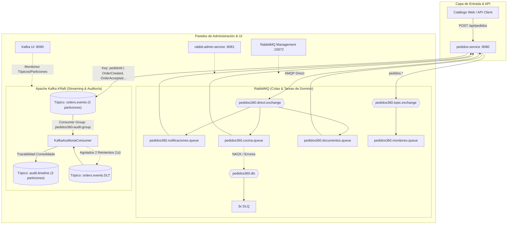

# Pedidos360 — Mensajería Asíncrona (RabbitMQ) y Streaming de Eventos (Apache Kafka)

**DSY1107 Desarrollo Cloud Native I** · Evaluaciones Parciales 3, 4, 5 y 6

Integrantes: Rene Marambio · _(completar)_

Pedidos360 integra una **arquitectura híbrida orientada a eventos**:
1. **Mensajería asíncrona con RabbitMQ (AMQP)**: Distribuye comandos y tareas a tres dominios desacoplados: **notificaciones** (correo al cliente), **cocina** (ticket de preparación) y **documentos** (boleta). Incluye colas de reintentos con TTL y Dead Letter Queues (DLQ).
2. **Streaming de eventos en tiempo real con Apache Kafka**: Captura y transmite el ciclo de vida continuo de los pedidos (`orders.events`) garantizando orden estricto por pedido mediante particionamiento por clave (`pedidoId`), registro distribuido en auditoría (`audit.timeline`), gestión de fallos con Dead Letter Topics (`orders.events.DLT`) y visualización en tiempo real vía **Kafka UI** en el puerto `8090`.

---

## Arquitectura



### Componentes de la Plataforma

| Componente | Rol y Descripción | Puerto |
|---|---|---|
| `pedidos-service` | Microservicio Spring Boot 3.3 (Java 21). Productor y consumidor dual de RabbitMQ y Apache Kafka. | `8080` |
| `rabbit-admin-service` | API REST para administración de RabbitMQ (Swagger en `/swagger-ui.html`). | `8081` |
| `rabbit1`, `rabbit2` | Clúster RabbitMQ 3.13 de 2 nodos con replicación Erlang. | `5672`, `5673`, `15672`, `15673` |
| `kafka` | Apache Kafka 3.7 en **modo nativo KRaft** (sin ZooKeeper). 3 particiones por tópico. | `9092` (host) / `29092` (docker) |
| `kafka-ui` | Panel web de administración y monitoreo de Apache Kafka (Kafbat/Kafka UI). | `8090` |

---

## Streaming de Eventos con Apache Kafka

### 1. Tópicos y Particionado

Declarados programáticamente en `KafkaInfraestructuraConfig.java`:

| Tópico | Particiones | Factor Replicación | Clave (Key) | Propósito |
|---|---|---|---|---|
| `orders.events` | 3 | 1 (configurable) | `pedidoId` | Eventos de dominio del ciclo de vida del pedido. La clave garantiza afinidad de partición y orden estricto. |
| `audit.timeline` | 3 | 1 (configurable) | `pedidoId` | Histórico consolidado de auditoría, trazabilidad y estado global. |
| `orders.events.DLT` | 3 | 1 (configurable) | `pedidoId` | Dead Letter Topic para eventos no procesables tras agotar reintentos. |

> [!IMPORTANT]
> **Garantía de Orden Estricto**: Todo evento publicado a través de `KafkaPedidoEventPublisher` asigna obligatoriamente el `pedidoId` como Record Key. De acuerdo con el algoritmo de particionamiento estándar de Kafka (`murmur2(key) % partitions`), todos los eventos del mismo pedido viajan a la misma partición y son consumidos exactamente en el orden cronológico en que fueron emitidos.

### 2. Envelope Común de Eventos (`PedidoEventoDTO`)

Los eventos se publican en formato JSON serializado:

```json
{
  "eventId": "e932b13c-70e2-41ba-a10c-98ebbc9d8731",
  "timestamp": "2026-10-29T16:30:00Z",
  "tipoEvento": "OrderCreated",
  "payloadPedido": {
    "pedidoId": 3001,
    "idPedido": "PED-3001",
    "nombreProducto": "Hamburguesa Doble Queso 360",
    "cantidad": 2,
    "precioUnitario": 7990,
    "total": 15980
  },
  "traceId": "c55d011d-2bbf-4f27-a63e-324f603c4cf7"
}
```

Tipos de eventos soportados (`TipoEventoPedido`):
- `OrderCreated`: Pedido ingresado desde el catálogo web.
- `OrderAccepted`: Pedido validado y aceptado en el sistema.
- `OrderPreparing`: Cocina confirma la comanda y comienza la preparación.
- `OrderDispatched`: Pedido empaquetado, boleta emitida y listo para despacho.
- `OrderDelivered`: Pedido entregado al cliente final con calificación.
- `OrderCancelled`: Pedido anulado con motivo registrado.

### 3. Consumidor de Auditoría (`KafkaAuditoriaConsumer`)

- **Consumer Group**: `pedidos360-audit-group`
- Registra en logs estructurados:
  - **Quién/Qué**: Tipo de evento (`tipoEvento`), `pedidoId`, `traceId`, `eventId`.
  - **Cuándo**: Marca de tiempo del evento (`timestamp`) y marca de tiempo del broker Kafka.
  - **Ubicación**: Tópico, Partición (`partition`) y Offset (`offset`).
- Emite la entrada respectiva a `audit.timeline`.

### 4. Manejo de Errores y Dead Letter Topic (DLT)

Configurado en `KafkaInfraestructuraConfig.java`:
- **Handler**: `DefaultErrorHandler` con `FixedBackOff(1000L, 2L)` (2 reintentos con intervalo de 1 segundo, 3 intentos en total).
- **Recuperador**: `DeadLetterPublishingRecoverer` que desvía mensajes fallidos a `${record.topic()}.DLT` (`orders.events.DLT`).
- **DLT Listener**: `KafkaAuditoriaConsumer.procesarDlt` captura y audita los mensajes desviados.

### 5. Eventos Emitidos por los Dominios y Sincronización de Orden

En la arquitectura híbrida de Pedidos360, los eventos del ciclo de vida se originan desde dos fuentes coordinadas:
1. **API REST Operacional (`PedidoService`)**: Publica los eventos principales del ciclo de vida (`OrderCreated`, `OrderAccepted`, `OrderDelivered`). Para evitar condiciones de carrera, `PedidoService` realiza una **publicación síncrona en Kafka esperando confirmación del broker** (`kafkaTemplate.send(...).get(5, TimeUnit.SECONDS)`) y **SOLO DESPUÉS** distribuye el mensaje a RabbitMQ.
2. **Eventos Emitidos por los Dominios (`CocinaService`, `DocumentoService`)**:
   - **Dominio Cocina**: Al procesar la comanda aceptada vía RabbitMQ, genera el ticket interno `COC-{id}` y emite el evento de dominio `OrderPreparing` hacia Kafka con clave `pedidoId`.
   - **Dominio Documentos**: Al emitir la boleta tributaria `BOL-{id}` vía RabbitMQ, emite el evento de dominio `OrderDispatched` hacia Kafka con clave `pedidoId`.
   - **Idempotencia y Prevención de Duplicados**: Ambos servicios mantienen un registro concurrente en memoria (`ConcurrentHashMap.newKeySet()`) para garantizar que no se emitan eventos duplicados del mismo tipo para un mismo pedido. Asimismo, el consumidor de la línea de tiempo (`AuditTimelineConsumer`) deduplica transiciones consecutivas idénticas, garantizando una secuencia estricta en el timeline:
     `OrderCreated` → `OrderAccepted` → `OrderPreparing` → `OrderDispatched` → `OrderDelivered`.

---

## Topología RabbitMQ (Capa Asíncrona Previa)

Centralizada en `application.yml` (`pedidos360.rabbit`):

| Exchange | Tipo | Routing Key | Cola | DLQ / Reintento |
|---|---|---|---|---|
| `pedidos360.direct.exchange` | direct | `notificaciones` | `pedidos360.notificaciones.queue` | `pedidos360.notificaciones.retry` (5s) / `pedidos360.notificaciones.dlq` |
| `pedidos360.direct.exchange` | direct | `cocina` | `pedidos360.cocina.queue` | `pedidos360.cocina.retry` (5s) / `pedidos360.cocina.dlq` |
| `pedidos360.direct.exchange` | direct | `documentos` | `pedidos360.documentos.queue` | `pedidos360.documentos.retry` (5s) / `pedidos360.documentos.dlq` |
| `pedidos360.topic.exchange` | topic | `pedidos.#` | `pedidos360.monitoreo.queue` | TTL 1h / máx. 500 mensajes |

---

## API REST de Pedidos y Streaming

| Método | Endpoint | Descripción | Evento Kafka |
|---|---|---|---|
| `POST` | `/api/pedidos` | Crear pedido desde catálogo | Publica `OrderCreated` a Kafka + RabbitMQ |
| `POST` | `/api/lab/pedidos/aceptar` | Aceptar pedido con flags de fallo | Publica `OrderAccepted` a Kafka + RabbitMQ |
| `POST` | `/api/pedidos/{id}/estado` | Actualizar estado genérico | Publica evento según payload |
| `POST` | `/api/pedidos/{id}/entregar` | Marcar pedido como entregado | Publica `OrderDelivered` a Kafka |
| `POST` | `/api/pedidos/{id}/cancelar` | Cancelar pedido | Publica `OrderCancelled` a Kafka |
| `POST` | `/api/lab/kafka/simular-dlt` | Simular fallo no recuperable en auditoría | Demuestra reintentos (2x 1s) y envío a DLT |
| `GET` | `/api/status` | Estado del microservicio, brokers y tópicos | Información de RabbitMQ y Kafka |

---

## Ejecución Local y Pruebas

### 1. Variables de Entorno

```bash
cp .env.example .env
```

### 2. Despliegue con Docker Compose

```bash
docker compose up -d --build
docker compose ps
```

Acceso a servicios:
- **Catálogo Web**: http://localhost:8080
- **Kafka UI**: http://localhost:8090
- **RabbitMQ Management**: http://localhost:15672 (`labuser` / `labpass`)
- **Rabbit Admin Swagger**: http://localhost:8081/swagger-ui.html

### 3. Pruebas Unitarias y de Integración

Se ejecutan con Java 21:

```powershell
$env:JAVA_HOME = "C:\Program Files\Eclipse Adoptium\jdk-21.0.9.10-hotspot"
cd pedidos-service
.\mvnw.cmd test
```

> [!NOTE]
> Las pruebas unitarias de Kafka (`KafkaPedidoEventPublisherTest`, `KafkaAuditoriaConsumerTest`, `KafkaInfraestructuraConfigTest`) prueban completamente la lógica de particionado, envelope, listener y error handling sin requerir un cluster Kafka activo.

---

## Guion de Demostración (Script `scripts/demo.sh`)

Para ejecutar los flujos de demostración:

```bash
# Verificación de servicios y tópicos Kafka
./scripts/demo.sh ep5-status

# Creación de pedido y streaming OrderCreated
./scripts/demo.sh ep5-crear

# Ciclo de vida completo (OrderCreated -> Accepted -> Preparing -> Dispatched -> Delivered)
./scripts/demo.sh ep5-ciclo

# Manejo de errores: reintentos y desvío hacia Dead Letter Topic (orders.events.DLT)
./scripts/demo.sh ep5-dlt

# Acceso al panel web Kafka UI
./scripts/demo.sh ep5-ui

# Flujos de RabbitMQ (EP3 / EP4)
./scripts/demo.sh cluster
./scripts/demo.sh colas
./scripts/demo.sh flujo
./scripts/demo.sh fallo
```
