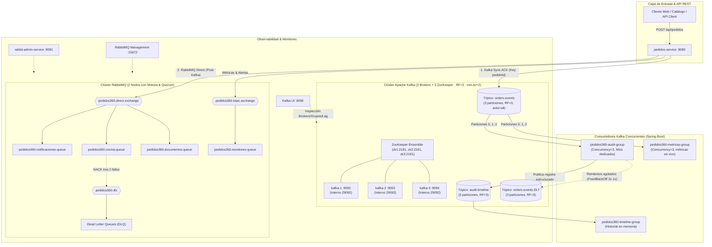

# Pedidos360 — Mensajería Asíncrona (RabbitMQ) y Streaming de Eventos (Apache Kafka)

**DSY1107-002 Desarrollo Cloud Native I · EP5 + EP6 · Trabajo individual: Rene Marambio**

---

## 1. Alcance del Proyecto

Este repositorio implementa la solución integral de **mensajería asíncrona y streaming de eventos distribuidos** para la plataforma **Pedidos360**, abarcando los requerimientos de las evaluaciones **EP5 y EP6**:

- **Capa Asíncrona con RabbitMQ (AMQP)**: Distribución desacoplada de tareas operativas hacia los dominios de **Notificaciones** (confirmación por correo), **Cocina** (comanda y ticket de preparación) y **Documentos** (emisión de boleta electrónica). Incorpora clúster de alta disponibilidad con 2 nodos, colas de reintentos temporizadas (TTL de 5 segundos) y colas de mensajes no procesables (Dead Letter Queues / DLQ).
- **Capa de Streaming con Apache Kafka**: Captura y distribución en tiempo real del ciclo de vida de las órdenes de negocio (`orders.events`), garantizando **orden cronológico estricto por pedido** mediante particionamiento por clave (`pedidoId`), registro de trazabilidad forense (`audit.timeline`), manejo de errores y Dead Letter Topics (`orders.events.DLT`), clúster de 3 brokers con replicación cruzada ($RF=3$), múltiples consumer groups concurrentes y panel de visualización centralizado en **Kafka UI** (puerto `8090`).
- **Control y Administración Automatizada**: API REST interna basada en `AdminClient` (`KafkaAdminController`) y scripts reproducibles (`scripts/kafka-admin.sh` y `scripts/demo.sh`) para la gestión de tópicos, políticas de retención, inspección de consumer lag y simulación de tolerancia a fallos.

---

## 2. Arquitectura de la Plataforma



### Componentes de Infraestructura

| Componente | Contenedor Docker | Tecnología / Imagen | Puertos Host | Rol en la Solución |
|---|---|---|---|---|
| **pedidos-service** | `pedidos360-pedidos` | Spring Boot 3.3.5 (Java 21) | `8080` | Núcleo de negocio: API REST, productor Kafka sincrónico, productor RabbitMQ y 3 consumer groups. |
| **rabbit-admin-service** | `pedidos360-rabbit-admin` | Spring Boot 3.3 (Java 21) | `8081` | Microservicio de gestión y monitoreo REST de la topología RabbitMQ con OpenAPI/Swagger. |
| **RabbitMQ Nodo 1** | `pedidos360-rabbit1` | `rabbitmq:3.13-management` | `5672`, `15672` | Nodo principal del clúster RabbitMQ y panel de administración web. |
| **RabbitMQ Nodo 2** | `pedidos360-rabbit2` | `rabbitmq:3.13-management` | `5673`, `15673` | Nodo réplica secundario del clúster RabbitMQ. |
| **ZooKeeper 1, 2, 3** | `pedidos360-zk1..3` | `cp-zookeeper:7.6.1` | `2181`, `2888`, `3888` | Quorum de coordinación distribuida y consenso para el clúster Kafka. |
| **Kafka Broker 1** | `pedidos360-kafka1` | `cp-kafka:7.6.1` | `9092` (interno `29092`) | Broker líder y réplica. Factor de replicación 3. |
| **Kafka Broker 2** | `pedidos360-kafka2` | `cp-kafka:7.6.1` | `9093` (interno `29092`) | Broker líder y réplica. Factor de replicación 3. |
| **Kafka Broker 3** | `pedidos360-kafka3` | `cp-kafka:7.6.1` | `9094` (interno `29092`) | Broker líder y réplica. Factor de replicación 3 (usado en pruebas de tolerancia a fallos). |
| **Kafka UI** | `pedidos360-kafka-ui` | `provectuslabs/kafka-ui:latest` | `8090` | Panel gráfico interactivo para inspeccionar clúster, tópicos, mensajes, consumer groups y lag. |

---

## 3. Topología de Tópicos en Apache Kafka

Declarados programáticamente en `KafkaInfraestructuraConfig.java` mediante Spring Kafka `NewTopic` / `TopicBuilder`:

| Tópico | Particiones | Factor Replicación ($RF$) | Política Retención (`retention.ms`) | `cleanup.policy` | Clave de Registro (`Record Key`) | Propósito Arquitectónico |
|---|:---:|:---:|:---:|:---:|:---:|---|
| `orders.events` | **3** | **3** | `604800000` (7 días) | `delete` | `pedidoId` | Tópico principal de eventos del ciclo de vida del pedido. La clave numérica garantiza la función hash consistente `murmur2(key) % 3` para orden cronológico estricto. |
| `audit.timeline` | **3** | **3** | `2592000000` (30 días) | `delete` | `pedidoId` | Tópico de auditoría forense. Contiene metadatos consolidados enriquecidos (timestamp del evento, timestamp del broker, partición original, offset y traceId). |
| `orders.events.DLT` | **3** | **3** | `1209600000` (14 días) | `delete` | `pedidoId` | Dead Letter Topic (DLT) para aislar mensajes corruptos o fallidos tras agotar reintentos automáticos, evitando bloqueo de particiones. |

---

## 4. Consumer Groups y Desacoplamiento

El sistema implementa el patrón **Publish-Subscribe / Fan-Out** en Apache Kafka: múltiples grupos de consumidores independientes leen el mismo tópico de eventos (`orders.events`) sin interferir entre sí.

| Consumer Group ID | Tópico Suscrito | Concurrencia (`concurrency`) | Clase Implementadora | Rol y Comportamiento |
|---|---|:---:|---|---|
| `pedidos360-audit-group` | `orders.events` | **3** | `KafkaAuditoriaConsumer` | Consumidor principal de auditoría. 3 hilos asignados individualmente a cada partición (0, 1 y 2). Registra metadatos estructurados y publica en `audit.timeline`. |
| `pedidos360-metricas-group` | `orders.events` | **3** | `MetricasPedidosConsumer` | Consumidor independiente de telemetría. Contabiliza en tiempo real eventos por tipo, partición e hilo asignado. Expone contadores vía `GET /api/kafka/metricas`. |
| `pedidos360-timeline-group` | `audit.timeline` | **1** | `AuditTimelineConsumer` | Consumidor de la línea de tiempo histórica. Almacena en memoria concurrente el historial por `pedidoId` y expone `GET /api/pedidos/{id}/timeline`. |
| `pedidos360-audit-group-dlt` | `orders.events.DLT` | **1** | `KafkaAuditoriaConsumer.procesarDlt` | Consumidor especializado de recuperación que escucha y alerta sobre mensajes desviados al Dead Letter Topic. |

### ¿Por qué dos grupos leen `orders.events` de forma independiente?
En Apache Kafka, un grupo de consumidores mantiene su propio cursor de lectura (`committed offset`) y métricas de atraso (`consumer lag`).
1. **Desacoplamiento Operacional**: La auditoría forense y el cálculo de métricas de rendimiento tienen ciclos de vida y tolerancias de latencia distintas.
2. **Aislamiento de Fallos y Cuellos de Botella**: Si el componente de métricas se ralentiza o requiere reiniciar sus estadísticas, el grupo de auditoría no se detiene ni experimenta lag inducido.
3. **Escalabilidad Horizontal Independiente**: Cada grupo escala sus hilos o réplicas de acuerdo con su propia demanda de cómputo sin alterar las particiones subyacentes.

---

## 5. Flujo Productor $\rightarrow$ Consumidor y Garantía de Orden

### Sincronización Kafka antes de RabbitMQ
En [PedidoService.java](file:///c:/Users/ithan/Downloads/p360-final/pedidos-service/src/main/java/cl/duoc/dsy1107/pedidos360/pedidos/service/PedidoService.java), el flujo de emisión sigue una política estricta de orden:

1. **Publicación Sincrónica en Kafka**: Se envía el evento hacia `orders.events` con clave `pedidoId` y se bloquea el hilo esperando el ACK del clúster:
   ```java
   kafkaPublisher.publicarEventoPedido(evento).get(5, TimeUnit.SECONDS);
   ```
2. **Distribución en RabbitMQ**: Únicamente tras recibir confirmación del broker Kafka con su partición y offset asignados, se publican las tareas asíncronas en RabbitMQ (`pedidos360.direct.exchange`).
3. **Razón Arquitectónica**: Evita condiciones de carrera donde los consumidores de cocina o documentos en RabbitMQ procesen el mensaje en paralelo y emitan eventos de estado subsecuentes (`OrderPreparing` o `OrderDispatched`) antes de que `OrderCreated` obtenga su offset en Kafka.

### Envelope Común de Eventos (`PedidoEventoDTO`)

Estructura inmutable JSON implementada como Java Record:

```json
{
  "eventId": "103dd791-c7e1-4d18-b3ca-6f7a6882442d",
  "timestamp": "2026-11-21T03:00:31.036671109Z",
  "tipoEvento": "OrderCreated",
  "payloadPedido": {
    "pedidoId": 3050,
    "idPedido": "PED-3050",
    "nombreProducto": "Pizza Familiar 360",
    "precio": 12990,
    "cantidad": 1,
    "origen": "CATALOGO_WEB"
  },
  "traceId": "04b5763d-d5ba-407e-8e74-99c3d93d8ef3"
}
```

**Tipos de eventos soportados (`TipoEventoPedido`):**
- `OrderCreated`: Creación y registro inicial del pedido.
- `OrderAccepted`: Confirmación del pago y aceptación operativa.
- `OrderPreparing`: Ticket de cocina generado y comanda en preparación.
- `OrderDispatched`: Boleta tributaria emitida y pedido despachado.
- `OrderDelivered`: Pedido entregado al cliente final con calificación.
- `OrderCancelled`: Cancelación formal con motivo registrado.

---

## 6. Manejo de Errores, Reintentos y Dead Letter Topic (DLT)

Configuración de resiliencia en `KafkaInfraestructuraConfig.java`:

- **ErrorHandler Centralizado**: `DefaultErrorHandler` asociado a la factoría de contenedores `ConcurrentKafkaListenerContainerFactory`.
- **Estrategia de BackOff**: `FixedBackOff(1000L, 2L)`: ante una excepción no controlada en el consumidor, se realizan **2 reintentos adicionales** con un intervalo de **1000 ms** (3 intentos totales de entrega).
- **Enrutamiento a Dead Letter Topic**: Si se agotan los reintentos, el componente `DeadLetterPublishingRecoverer` desvía automáticamente el registro fallido al tópico `${record.topic()}.DLT` (`orders.events.DLT`), preservando la partición de origen.
- **Trazabilidad de Fallo**: Se inyectan encabezados Kafka en el registro DLT con el stacktrace, la causa original del error, el tópico de procedencia y el offset en que ocurrió el fallo.

---

## 7. Catálogo de Endpoints REST

### 7.1. API de Negocio y Streaming (`pedidos-service` :8080)

| Método | Endpoint | Descripción | Evento Kafka Emitido / Consumido |
|---|---|---|---|
| `POST` | `/api/pedidos` | Crea un nuevo pedido desde el catálogo | Publica `OrderCreated` en Kafka y distribuye a RabbitMQ |
| `POST` | `/api/lab/pedidos/aceptar` | Acepta el pedido y simula validación de pago | Publica `OrderAccepted` en Kafka y notifica dominios |
| `POST` | `/api/pedidos/{id}/estado` | Actualización de estado operativo (ej: cocina/despacho) | Publica evento según payload (`OrderPreparing`, `OrderDispatched`) |
| `POST` | `/api/pedidos/{id}/entregar` | Registra entrega final al cliente con reseña | Publica `OrderDelivered` en Kafka |
| `POST` | `/api/pedidos/{id}/cancelar` | Cancela el pedido indicando motivo | Publica `OrderCancelled` en Kafka |
| `POST` | `/api/lab/kafka/simular-dlt` | Provoca fallo intencional en auditoría (simulación DLT) | Activa reintentos (2x 1s) y desvía mensaje a `orders.events.DLT` |
| `GET` | `/api/status` | Estado de salud del microservicio y brokers conectados | Consulta conectividad RabbitMQ y Apache Kafka |
| `GET` | `/api/pedidos/{id}/timeline` | Devuelve la línea de tiempo cronológica del pedido | Lee registros consumidos desde `audit.timeline` |
| `GET` | `/api/kafka/metricas` | Muestra contadores de consumo en tiempo real | Detalla eventos por tipo, partición y nombre de hilo receptor |

### 7.2. API de Administración Kafka con `AdminClient` (`KafkaAdminController`)

| Método | Endpoint | Código Éxito | Códigos Error | Descripción Funcional |
|---|---|:---:|:---:|---|
| `GET` | `/api/kafka/admin/topics` | `200 OK` | `500` | Lista todos los tópicos del clúster indicando número de particiones, factor de replicación, broker líder e integrantes del ISR por partición. |
| `POST` | `/api/kafka/admin/topics` | `201 Created` | `400, 409, 500` | Crea un tópico dinámicamente (`nombre`, `particiones`, `replicas`). Valida que los parámetros sean positivos y responde `409 Conflict` si ya existe. |
| `PUT` | `/api/kafka/admin/topics/{nombre}/retention?ms=...` | `200 OK` | `400, 404, 500` | Modifica en caliente la política de retención (`retention.ms`) usando `incrementalAlterConfigs`. Valida tiempo positivo y existencia del tópico. |
| `DELETE` | `/api/kafka/admin/topics/{nombre}` | `200 OK` | `400, 404, 500` | Elimina un tópico de prueba. **Bloquea y rechaza con 400 Bad Request** cualquier intento de borrar tópicos protegidos del sistema (`orders.events`, `audit.timeline`, `orders.events.DLT`). |
| `GET` | `/api/kafka/admin/groups` | `200 OK` | `500` | Lista los consumer groups registrados en el clúster con su estado (`Stable`, `Empty`, etc.) y detalle de miembros activos. |
| `GET` | `/api/kafka/admin/groups/{groupId}/lag` | `200 OK` | `404, 500` | Calcula y desglosa el lag por partición: `committedOffset`, `endOffset` y `lag = endOffset - committedOffset`. |

---

## 8. Scripts de Demostración y Diagnóstico Replicable

Los scripts se ubican en la carpeta `scripts/` y están diseñados para ejecutarse con **Git Bash** en Windows.

### 8.1. `scripts/demo.sh` — Flujos Operacionales y Demostración

```bash
# Ejecución general en Git Bash:
bash scripts/demo.sh <bloque>
```

| Bloque | Comando | Descripción |
|---|---|---|
| `ep5-status` | `bash scripts/demo.sh ep5-status` | Verifica estado de `pedidos-service` y lista tópicos en el clúster Kafka. |
| `ep5-crear` | `bash scripts/demo.sh ep5-crear` | Crea un pedido en catálogo y verifica la publicación de `OrderCreated` en Kafka y RabbitMQ. |
| `ep5-ciclo` | `bash scripts/demo.sh ep5-ciclo` | Ejecuta el ciclo completo de un pedido (Created $\rightarrow$ Accepted $\rightarrow$ Preparing $\rightarrow$ Dispatched $\rightarrow$ Delivered) con orden estricto. |
| `ep5-carga` | `bash scripts/demo.sh ep5-carga` | Genera una ráfaga de **12 pedidos concurrentes** (IDs 4001 a 4012), evidenciando distribución en las 3 particiones y consumo balanceado en los 3 hilos. |
| `ep5-dlt` | `bash scripts/demo.sh ep5-dlt` | Simula un fallo en auditoría, evidencia los 2 reintentos con pausa y el desvío hacia `orders.events.DLT`. |
| `ep5-ui` | `bash scripts/demo.sh ep5-ui` | Muestra URLs y credenciales para el panel de monitoreo Kafka UI en `http://localhost:8090`. |
| `timeline` | `bash scripts/demo.sh timeline 3050` | Consulta la línea de tiempo en memoria para un pedido específico (`/api/pedidos/{id}/timeline`). |
| `metricas` | `bash scripts/demo.sh metricas` | Muestra las métricas de consumo en tiempo real (`/api/kafka/metricas`). |
| `grupos` | `bash scripts/demo.sh grupos` | Lista los consumer groups registrados vía CLI y vía API REST. |
| `lag` | `bash scripts/demo.sh lag` | Consulta el lag de los grupos activos por partición. |
| `cluster`, `colas`, `flujo`, `fallo` | `bash scripts/demo.sh <bloque>` | Pruebas de la topología RabbitMQ (EP3 y EP4). |

### 8.2. `scripts/kafka-admin.sh` — Administración y Resiliencia de Kafka

```bash
# Ejecución general en Git Bash:
bash scripts/kafka-admin.sh <bloque>
```

| Bloque | Comando | Descripción |
|---|---|---|
| `topics` | `bash scripts/kafka-admin.sh topics` | Describe tópicos con particiones, réplicas, líderes e ISR vía CLI y vía API REST. |
| `groups` | `bash scripts/kafka-admin.sh groups` | Lista los grupos y miembros activos en el clúster. |
| `lag` | `bash scripts/kafka-admin.sh lag` | Detalla committed offset, end offset y lag por partición de los consumer groups. |
| `retention` | `bash scripts/kafka-admin.sh retention orders.events 86400000` | Muestra la retención actual y la modifica dinámicamente mediante `incrementalAlterConfigs`. |
| `crear-topico-prueba` | `bash scripts/kafka-admin.sh crear-topico-prueba` | Crea el tópico `topico.prueba` con 3 particiones y RF=3 vía REST y lo valida por CLI. |
| `borrar-topico-prueba` | `bash scripts/kafka-admin.sh borrar-topico-prueba` | Elimina `topico.prueba` vía REST y valida que los tópicos del sistema estén protegidos (HTTP 400). |
| `fallo-broker` | `bash scripts/kafka-admin.sh fallo-broker` | **Prueba de Resiliencia**: Detiene `pedidos360-kafka3`, evidencia degradación de ISR a `[1, 2]`, reinicia el broker y evidencia recuperación completa a `[1, 2, 3]`. |
| `lag-demo` | `bash scripts/kafka-admin.sh lag-demo` | **Demostración de Lag**: Detiene `pedidos-service`, publica 20 mensajes válidos con `kafka-console-producer`, muestra acumulación de lag ($> 0$), inicia el servicio y evidencia drenaje total a lag = 0 sin mensajes en DLT. |

---

## 9. Despliegue, Configuración y Pruebas

### 9.1. Variables de Entorno (`.env.example`)

Copiar el archivo de plantilla a `.env`:

```bash
cp .env.example .env
```

Contenido de `.env.example`:
```properties
# RabbitMQ
RABBITMQ_USER=labuser
RABBITMQ_PASSWORD=cambie-esta-clave
RABBITMQ_ERLANG_COOKIE=cambie-esta-cookie-larga-y-secreta
AUDITORIA_DLQ_HABILITADA=true

# Apache Kafka (Clúster de 3 Brokers)
KAFKA_BOOTSTRAP_SERVERS=localhost:9092,localhost:9093,localhost:9094
KAFKA_CONSUMER_GROUP_ID=pedidos360-audit-group
```

### 9.2. Despliegue con Docker Compose

```powershell
# Levantar clúster completo construyendo imágenes actualizadas
docker compose up -d --build

# Verificar que todos los servicios estén 'healthy' o 'running'
docker compose ps
```

### 9.3. Ejecución de Pruebas Automatizadas

El proyecto cuenta con **34 pruebas unitarias y de integración** automatizadas con JUnit 5 y Mockito:

```powershell
$env:JAVA_HOME = "C:\Users\ithan\.jdk\jdk-21.0.5+11"
cd pedidos-service
.\mvnw.cmd test
```

Resultado de ejecución:
```text
[INFO] Results:
[INFO] 
[INFO] Tests run: 34, Failures: 0, Errors: 0, Skipped: 0
[INFO] 
[INFO] ------------------------------------------------------------------------
[INFO] BUILD SUCCESS
[INFO] ------------------------------------------------------------------------
```

---

## 10. Mapa de la Rúbrica de Evaluación (EP5 y EP6)

A continuación se detalla la correspondencia punto a punto entre los indicadores de las rúbricas **EP5** y **EP6** y las piezas de código, endpoints o scripts que los respaldan:

### Rúbrica EP5 — Streaming de Eventos con Apache Kafka

| Indicador | Criterio de Evaluación | Evidencia en el Proyecto / Archivo | Endpoint o Script de Validación |
|---|---|---|---|
| **E5-01** | Despliegue de infraestructura Kafka multi-broker | `docker-compose.yml` (3 brokers Kafka Confluent 7.6.1 + 3 ZooKeeper con RF=3). | `docker compose ps` / `scripts/kafka-admin.sh topics` |
| **E5-02** | Declaración y configuración de tópicos | `KafkaInfraestructuraConfig.java` (`orders.events`, `audit.timeline`, `orders.events.DLT`, 3 particiones, RF=3, retention configurada). | `GET /api/kafka/admin/topics` / `scripts/demo.sh ep5-status` |
| **E5-03** | Estructura de envelope de eventos | `PedidoEventoDTO.java` y `TipoEventoPedido.java` (Record inmutable con eventId, timestamp, tipoEvento, payload, traceId). | `PedidoEventoDTO.java` / logs en `scripts/demo.sh ep5-crear` |
| **E5-04** | Particionado por clave y orden cronológico | `KafkaPedidoEventPublisher.java` (publica con clave `pedidoId`) y `PedidoService.java` (publicación síncrona). | `scripts/demo.sh ep5-ciclo` / `GET /api/pedidos/3050/timeline` |
| **E5-05** | Consumidor de auditoría de eventos | `KafkaAuditoriaConsumer.java` (`@KafkaListener` sobre `orders.events`, groupId `pedidos360-audit-group`, concurrencia 3). | Logs de `pedidos360-pedidos` / `scripts/demo.sh ep5-crear` |
| **E5-06** | Consolidación y línea de tiempo de auditoría | `AuditTimelineConsumer.java` (`@KafkaListener` sobre `audit.timeline`, groupId `pedidos360-timeline-group`). | `GET /api/pedidos/{id}/timeline` / `scripts/demo.sh timeline` |
| **E5-07** | Estrategia de reintentos y Dead Letter Topic | `KafkaInfraestructuraConfig.java` (`DefaultErrorHandler`, `FixedBackOff(1000, 2)`, `DeadLetterPublishingRecoverer`). | `POST /api/lab/kafka/simular-dlt` / `scripts/demo.sh ep5-dlt` |
| **E5-08** | Verificación de desvío hacia DLT | `KafkaAuditoriaConsumer.procesarDlt` (consumidor sobre `orders.events.DLT` que alerta y registra excepciones). | `scripts/demo.sh ep5-dlt` |
| **E5-09** | Observabilidad y monitoreo visual | Integración con contenedor `pedidos360-kafka-ui` (puerto 8090) con clúster y tópicos configurados. | `http://localhost:8090` / `scripts/demo.sh ep5-ui` |

### Rúbrica EP6 — Administración, Escalabilidad y Resiliencia en Kafka

| Indicador | Criterio de Evaluación | Evidencia en el Proyecto / Archivo | Endpoint o Script de Validación |
|---|---|---|---|
| **E6-01** | Consumo particionado multihilo | `concurrency = "3"` en `KafkaAuditoriaConsumer` y `MetricasPedidosConsumer` (un hilo por partición). | `GET /api/kafka/metricas` / `scripts/demo.sh ep5-carga` |
| **E6-02** | Múltiples Consumer Groups independientes | `pedidos360-audit-group` y `pedidos360-metricas-group` leyendo concurrentemente de `orders.events`. | `scripts/kafka-admin.sh groups` / `GET /api/kafka/admin/groups` |
| **E6-03** | Monitoreo y métricas de consumo en tiempo real | `MetricasPedidosConsumer.java` (contadores atómicos concurrentes por tipo, partición e hilo). | `GET /api/kafka/metricas` / `scripts/demo.sh metricas` |
| **E6-04** | Consulta administrativa de tópicos por API | `KafkaAdminController.java` método `listarTopicos` con `AdminClient.describeTopics`. | `GET /api/kafka/admin/topics` / `scripts/kafka-admin.sh topics` |
| **E6-05** | Creación y borrado dinámico con seguridad | `KafkaAdminController.java` (`crearTopico`, `eliminarTopico` con bloqueo HTTP 400 de tópicos protegidos). | `POST / DELETE /api/kafka/admin/topics` / `scripts/kafka-admin.sh crear-topico-prueba` |
| **E6-06** | Alteración en caliente de configuración de tópicos | `KafkaAdminController.java` método `modificarRetencion` con `incrementalAlterConfigs`. | `PUT /api/kafka/admin/topics/{n}/retention` / `scripts/kafka-admin.sh retention` |
| **E6-07** | Monitoreo programático de Consumer Lag | `KafkaAdminController.java` método `obtenerLagConsumerGroup` con `listConsumerGroupOffsets` y `listOffsets`. | `GET /api/kafka/admin/groups/{id}/lag` / `scripts/kafka-admin.sh lag` |
| **E6-08** | Tolerancia a fallos y recuperación de ISR | Clúster de 3 brokers con $RF=3$ y $min.insync.replicas=2$. Degradación de ISR ante broker caído y reintegro. | `scripts/kafka-admin.sh fallo-broker` |
| **E6-09** | Demostración de acumulación y drenaje de Lag | Simulación con consumidor detenido, inyección de 20 eventos con claves distintas y drenaje a cero. | `scripts/kafka-admin.sh lag-demo` |
